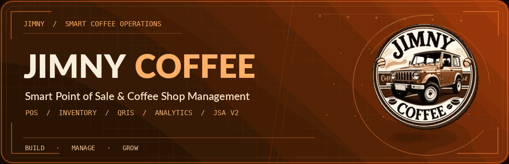

# JIMNY COFFEE

Sistem informasi kasir dan pengelolaan operasional kedai kopi berbasis web, dengan antarmuka khusus **Owner, Admin, dan Kasir**.

**[Fitur](docs/guides/README-LENGKAP.md#fitur-aplikasi)** · **[Preview](docs/guides/README-LENGKAP.md#preview-antarmuka)** · **[Instalasi](docs/guides/README-LENGKAP.md#menjalankan-project)** · **[Dokumentasi](docs/guides/README-LENGKAP.md)**

