## Lokasi Aplikasi Laravel

Seluruh aplikasi JIMNY COFFEE berada di folder `jimny-coffee/`.

Setelah clone repository, jalankan perintah berikut dari root repository:

    cd jimny-coffee
    composer install
    npm ci
    php artisan serve

Frontend Blade dan Vite tetap terintegrasi dengan Laravel.
Machine Learning berada di `jimny-coffee/scripts/`.

---

<div align="center">

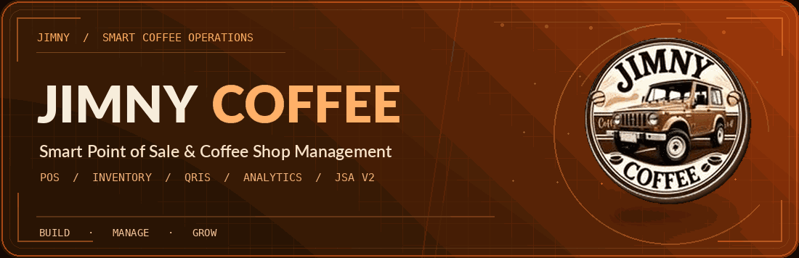


Sistem informasi kasir dan pengelolaan operasional kedai kopi berbasis web, dengan antarmuka khusus **Owner, Admin, dan Kasir**.


**[Fitur](docs/guides/README-LENGKAP.md#fitur-aplikasi)** · **[Preview](docs/guides/README-LENGKAP.md#preview-antarmuka)** · **[Instalasi](docs/guides/README-LENGKAP.md#menjalankan-project)** · **[Dokumentasi](docs/guides/README-LENGKAP.md)**

</div>

---

## Sekilas Project

**JIMNY COFFEE** adalah project aplikasi Point of Sale (POS) berbasis Laravel untuk membantu pengelolaan pesanan, transaksi, menu, stok, laporan penjualan, dan aktivitas karyawan dalam satu sistem. Tampilan aplikasi menggunakan nuansa warna kopi dan menyediakan halaman sesuai peran pengguna.

> **Status repository (November 2026):** Fitur POS, Smart Assistant Owner V20, pembaruan AI P1, dan antarmuka responsif V14 telah diintegrasikan ke `main` (PR [#37](https://github.com/Satar2007/Proyek-Informatika/pull/37)). Fitur prediksi statistik sudah tersedia; kualitas prediksi tetap bergantung pada data historis, bukan jaminan akurasi bisnis nyata. Pelatihan atau fine-tuning model Qwen3 menggunakan data toko **tidak** dilakukan.

## Fitur Aplikasi

| Peran | Area yang ditampilkan dalam project |
| :-- | :-- |
| **Kasir** | Pemilihan menu & pesanan, pencatatan transaksi, pilihan pembayaran Cash/QRIS, presensi & izin, riwayat transaksi, laporan penjualan. |
| **Admin** | Dashboard, pengelolaan menu, log stok, pengaturan shift, pengajuan izin, pengelolaan akun, dan riwayat transaksi. |
| **Owner** | Dashboard bisnis, laporan penjualan, tren, perbandingan periode, performa menu, prediksi permintaan, persiapan stok, dan rekap kehadiran. |
| **Smart Assistant** | Asisten Owner/Admin dan Kasir berbasis data POS, dengan analitik deterministik dan chatbot lokal Ollama/Qwen3 (opsional). |
| **Responsive GUI V14** | Penyesuaian antarmuka untuk layar mobile, foldable, tablet, laptop, dan desktop berdasarkan lebar viewport. |

## Smart Assistant Owner V20 & AI Lokal

JIMNY Smart Assistant menyatukan tiga kemampuan yang perlu dibedakan:

1. **Analitik deterministik Laravel/MySQL:** KPI penjualan, transaksi lunas, nilai rata-rata transaksi, tren harian, dan perbandingan dua periode. Untuk ringkasan historis Owner, hanya transaksi `status=success` dan `payment_status=paid` yang dihitung; **penjualan sebelum pajak** = `total - diskon`, sedangkan uang tertagih menggunakan `grand_total`.
2. **Sistem pendukung keputusan berbasis aturan:** prioritas operasional untuk kesegaran data, penurunan penjualan/menu, dan kecukupan stok. Saran bukan eksekusi pembelian atau perubahan stok otomatis.
3. **Chatbot AI lokal:** Laravel mengirim pertanyaan dan fakta POS yang telah dihitung ke model `qwen3:4b-instruct` melalui Ollama. Model membantu merangkai penjelasan dalam bahasa Indonesia, **bukan sumber angka penjualan**. Ketika Ollama tidak tersedia, tersedia jalur respons cadangan berbasis Laravel/POS.

Akses disesuaikan dengan peran: Owner/Admin dapat melihat analitik bisnis, sedangkan Kasir dibatasi pada data operasional sesuai otorisasi. Untuk pertanyaan Kasir tentang penjualan hari ini, sistem dapat menjawab secara langsung dari query POS tanpa bergantung pada model bahasa.

### Prediksi permintaan dan persiapan stok

Modul Owner V20 melakukan peramalan deret waktu dari transaksi historis, mengisi hari tanpa transaksi dengan nol dan membatasi ringkasan historis pada **hari kalender yang telah selesai**. Dua kandidat metode yang tersedia adalah:

- **Moving Average 28 hari (`mean28`)** sebagai baseline.
- **Weekday Blend**: `0,7 × rata-rata hari mingguan yang sama + 0,3 × rata-rata 28 hari` untuk menangkap pola mingguan.

Metode dipilih berdasarkan evaluasi kesalahan pada jendela historis terdahulu; jendela terakhir digunakan untuk pemeriksaan terpisah (*holdout*). Sistem melaporkan **galat absolut**, rentang **skenario**, dan catatan keterbatasan. Rentang tersebut **bukan** interval probabilitas terkalibrasi.

Rekomendasi persiapan stok per menu menggunakan rumus `maks(0, pembulatan ke atas prediksi kebutuhan 7 hari + stok minimum - stok tersedia)`. Ini adalah rekomendasi **porsi/menu**, bukan perhitungan otomatis bahan baku dan bukan perintah pembelian.

> **Keterbatasan data:** Dataset pengembangan dapat mencakup transaksi sintetis/dummy. Performa prediksi pada data tersebut tidak membuktikan akurasi operasional coffee shop nyata. Tidak adanya transaksi juga bisa berarti toko tutup atau pencatatan belum masuk. Owner perlu memverifikasi kesegaran data sebelum mengambil keputusan.

### Menjalankan chatbot lokal (opsional)

Jika ingin menggunakan jawaban AI generatif, pasang [Ollama](https://ollama.com/) pada komputer atau server yang menjalankan Laravel, lalu siapkan model yang digunakan source saat ini:

```powershell
ollama pull qwen3:4b-instruct
ollama list
```

Pastikan server Ollama aktif pada `http://127.0.0.1:11434` (misalnya melalui layanan Ollama atau `ollama serve` apabila belum berjalan). Source AI V20 menggunakan endpoint lokal `/api/chat`; **jangan menganggap `127.0.0.1` merujuk ke perangkat pengguna browser** bila Laravel berjalan pada mesin/server lain. Tanpa layanan Ollama, fitur POS/analitik tetap dapat digunakan; respons chatbot generatif akan beralih ke fallback sesuai endpoint.

### GUI responsif V14

Styling V14 diintegrasikan melalui layout dan komponen Blade, dengan stylesheet `jimny-coffee/public/css/jimny-responsive-v14.css` serta komponen `jimny-coffee/resources/views/components/jimny-responsive-v14.blade.php`. Gunakan Chrome/Edge DevTools untuk memeriksa viewport mobile, foldable, tablet, dan desktop; validasi kode tidak otomatis menjamin setiap ukuran layar bebas overflow.

## Preview Antarmuka

### Halaman Login

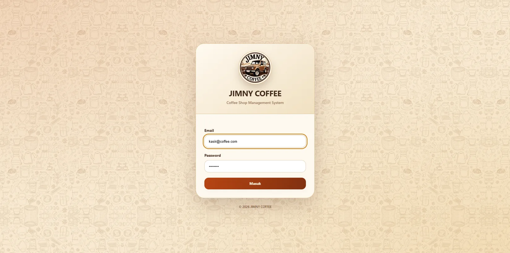

### Kasir / Point of Sale

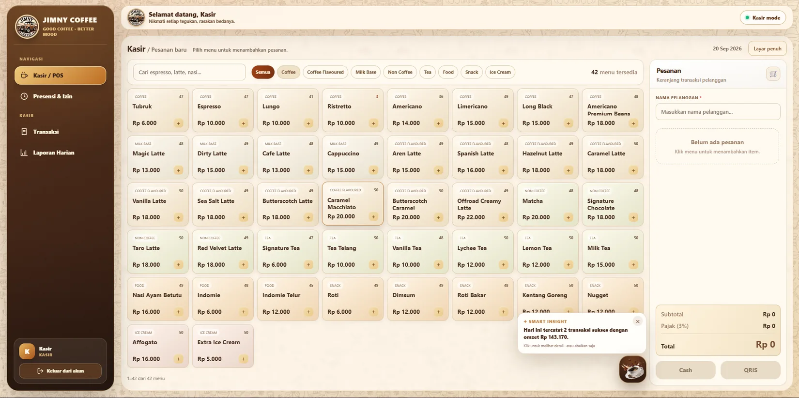

### Dashboard Owner

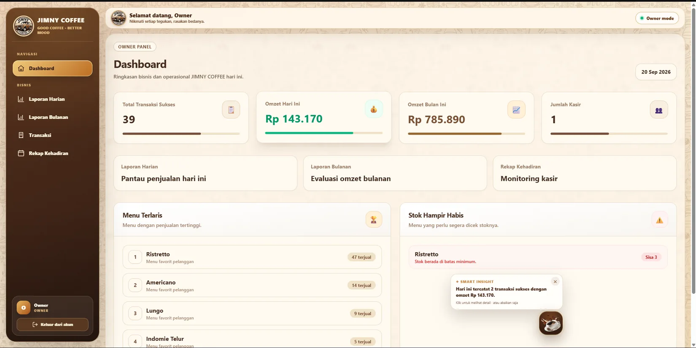

### Dashboard Admin

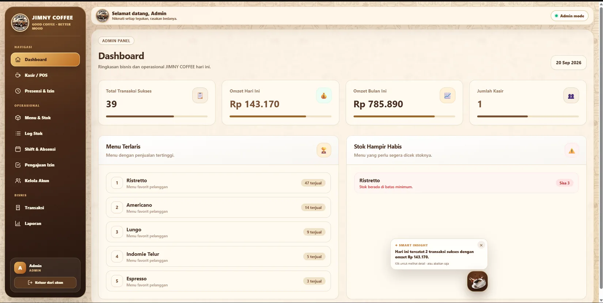

### Menu, Stok & Shift

| Kelola menu | Log stok |
| :--: | :--: |
| 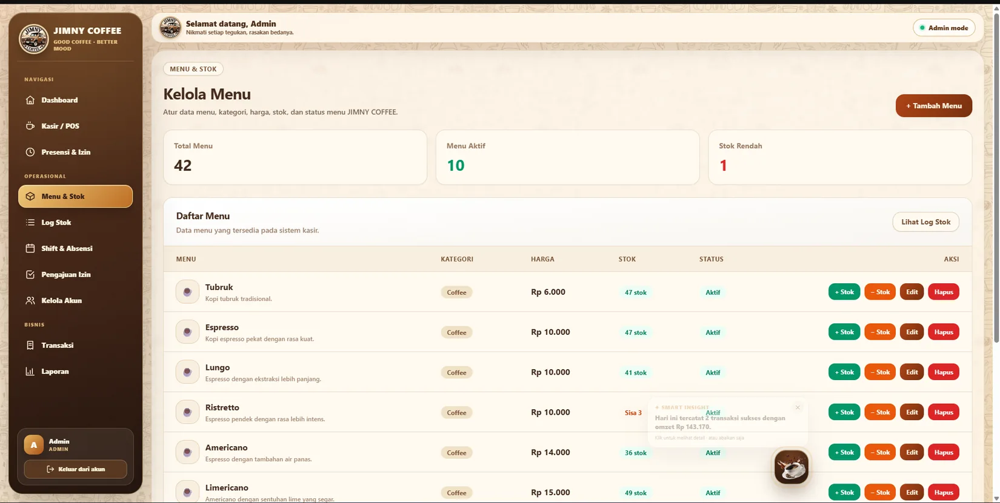 | 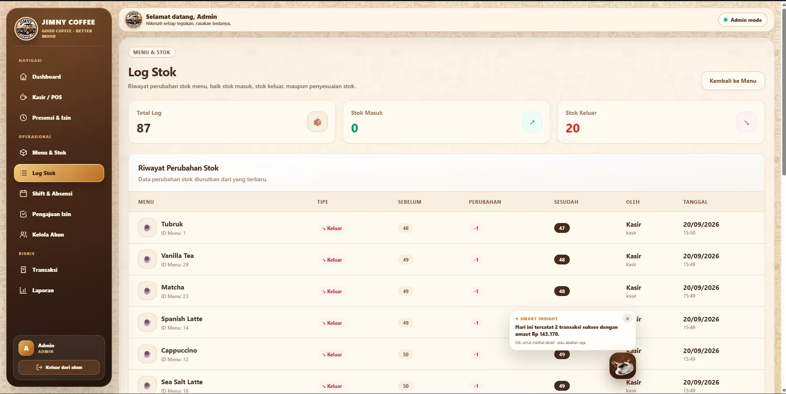 |

| Kelola shift | Kelola akun |
| :--: | :--: |
| 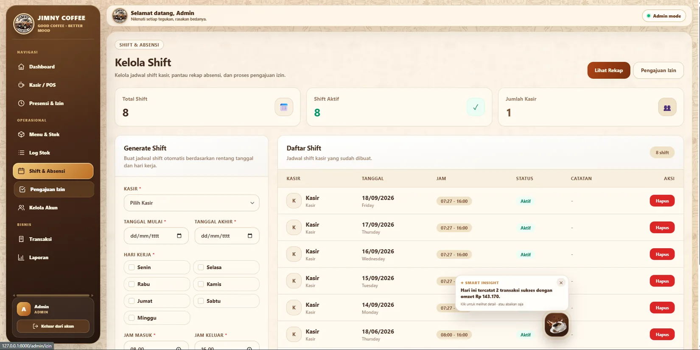 | 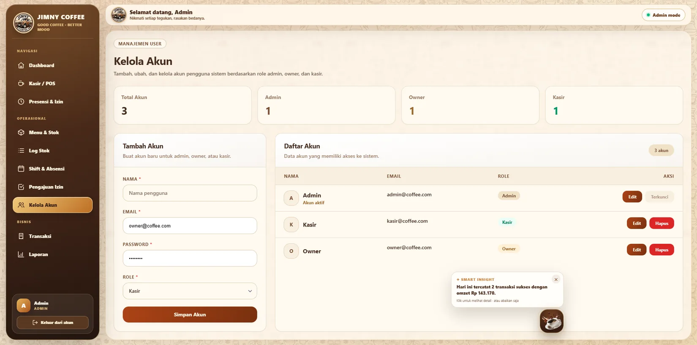 |

### Laporan & Aktivitas

| Laporan penjualan | Riwayat transaksi |
| :--: | :--: |
| 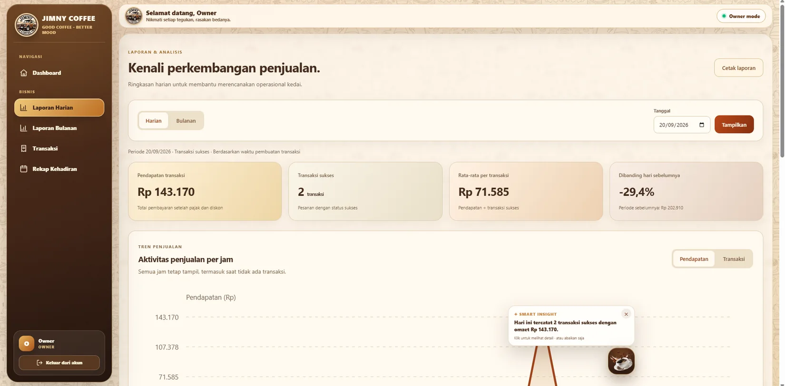 | 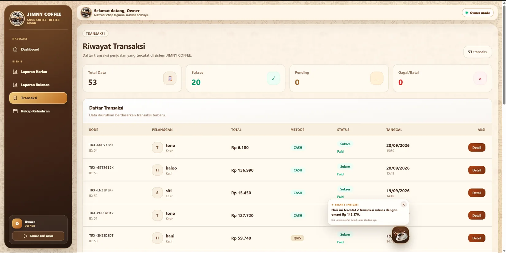 |

<details>
<summary><strong>Lihat galeri tampilan lainnya (9 screenshot)</strong></summary>

<br />

| Tampilan | Preview |
| :-- | :-- |
| Presensi & izin Kasir | 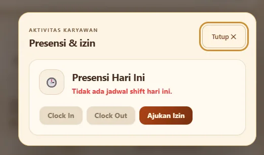 |
| Riwayat transaksi Kasir | 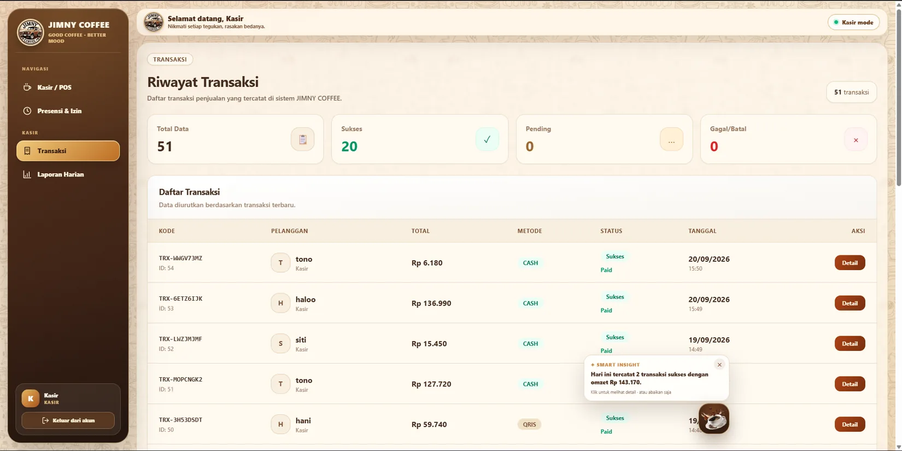 |
| Laporan penjualan Kasir | 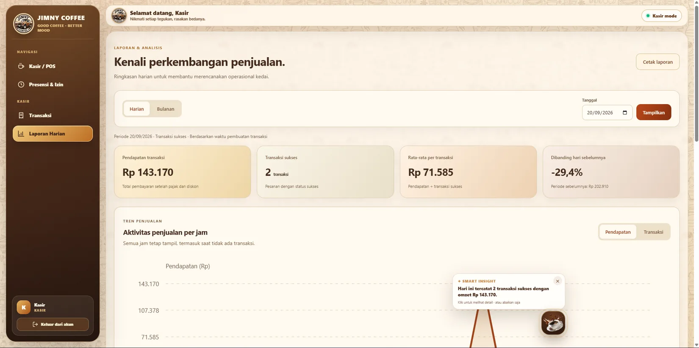 |
| Analitik penjualan Owner | 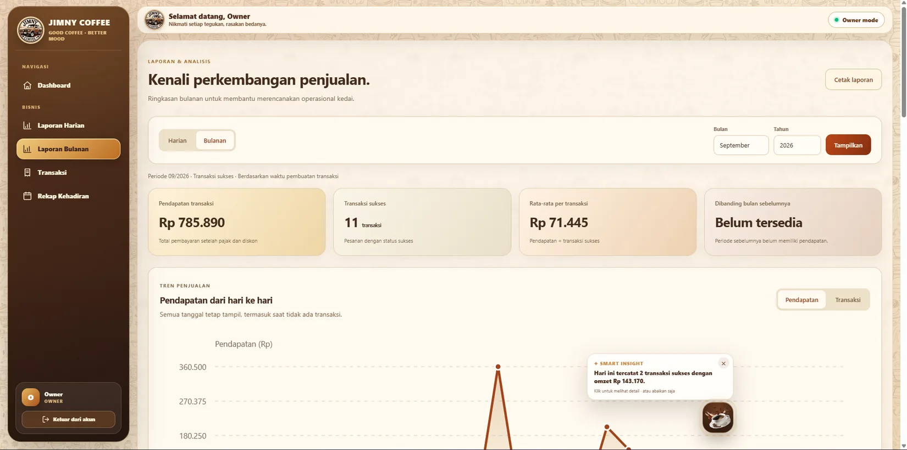 |
| Rekap kehadiran Owner | 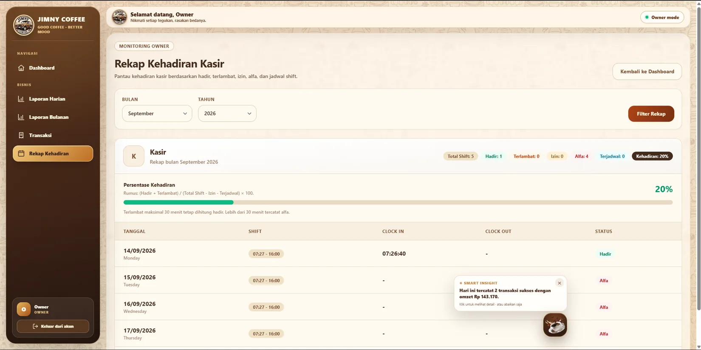 |
| POS Admin | 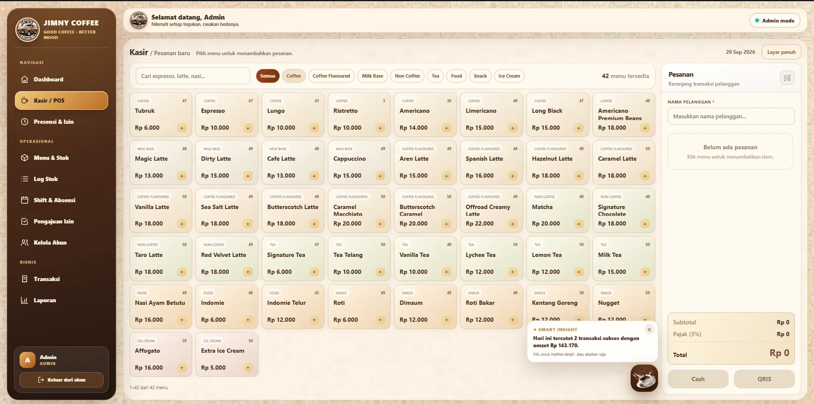 |
| Pengajuan izin Admin | 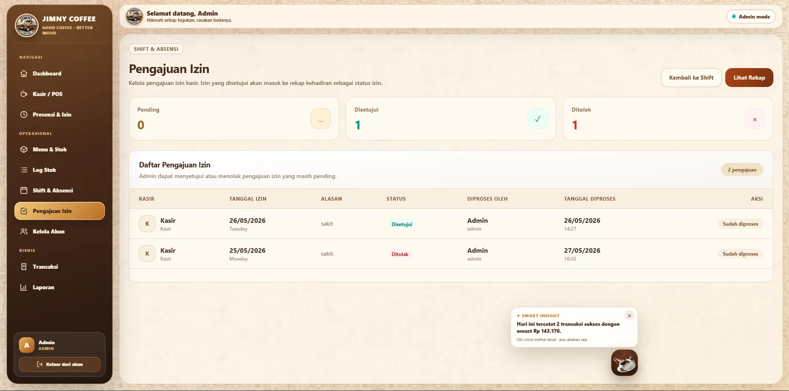 |
| Riwayat transaksi Admin | 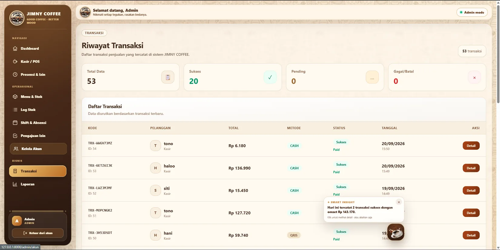 |
| Analitik penjualan Admin | 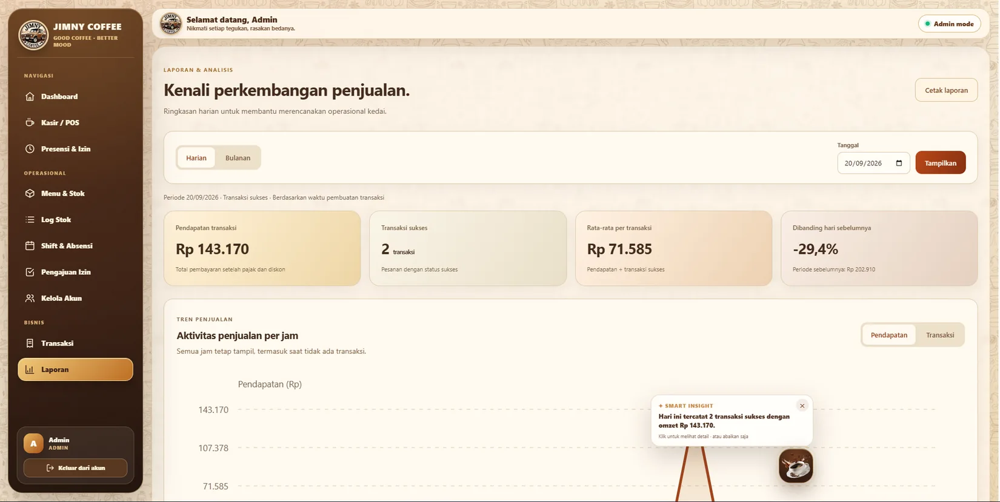 |

</details>

> Screenshot menunjukkan antarmuka pada saat pengambilan gambar. Angka penjualan, stok, dan transaksi yang terlihat merupakan contoh tampilan, bukan data operasional terkini.

## Teknologi

- **Backend:** PHP & Laravel
- **Database:** MySQL
- **Frontend:** Blade, Tailwind CSS, CSS, dan JavaScript
- **Build tools:** Composer, NPM, dan Vite
- **AI lokal opsional:** Ollama + Qwen3 4B Instruct
- **Analitik / forecasting:** Laravel SQL aggregation, rule-based recommendations, Moving Average 28 hari, Weekday Blend, evaluasi holdout
- **Kolaborasi:** Git & GitHub (branch dan pull request)

## Menjalankan Project

> Setelah seluruh source code tersedia, ikuti langkah berikut untuk
> menyiapkan project JIMNY COFFEE pada komputer lokal. Pastikan PHP,
> Composer, Node.js/NPM, Laragon, dan MySQL telah terpasang.

------------------------------------------------------------------------

### Persyaratan Sistem

Pastikan perangkat memiliki:

  Komponen        Keterangan
  --------------- -------------------------------
  PHP             Sesuai kebutuhan Laravel
  Composer        Dependency Laravel
  Node.js & NPM   Build frontend
  Laragon         Local development environment
  MySQL           Database aplikasi
  Git             Source code management

Cek instalasi:

``` bash
php -v
composer -v
node -v
npm -v
mysql --version
```

------------------------------------------------------------------------

### 1. Menyalakan Laragon

Buka aplikasi **Laragon**.

Pastikan:

MySQL aktif\
Apache/Nginx dapat diaktifkan jika diperlukan

Laragon digunakan untuk menyediakan environment Laravel dan database
MySQL lokal.

------------------------------------------------------------------------

### 2. Masuk ke Folder Project

Buka PowerShell atau Terminal.

Dari **root repository**, masuk terlebih dahulu ke folder aplikasi Laravel:

```powershell
Set-Location .\jimny-coffee
Test-Path .\artisan
```

Perintah `Test-Path` harus menghasilkan `True`. File `artisan`, `composer.json`, `package.json`, dan `.env.example` berada **di dalam `jimny-coffee/`**, bukan di root Git repository.

------------------------------------------------------------------------

### 3. Install Dependency Project

Install dependency backend Laravel:

``` bash
composer install
```

Install dependency frontend (gunakan lockfile bila tersedia):

```bash
npm ci
```

Jika `package-lock.json` tidak tersedia atau lockfile perlu dibuat untuk pengembangan, gunakan `npm install` sebagai alternatif.

------------------------------------------------------------------------

### 4. Konfigurasi Environment (.env)

Jika file `.env` belum tersedia, buat dari `.env.example`.

Windows PowerShell:

``` powershell
if (-not (Test-Path '.env')) {
    Copy-Item '.env.example' '.env'
}
```

Generate application key:

``` bash
php artisan key:generate
```

------------------------------------------------------------------------

### 5. Konfigurasi Database

Buka file:

    .env

Atur konfigurasi database:

``` env
DB_CONNECTION=mysql
DB_HOST=127.0.0.1
DB_PORT=3306
DB_DATABASE=satar_integrated
DB_USERNAME=root
DB_PASSWORD=
```

Catatan:

-   Pada Laragon default, username MySQL biasanya `root`
-   Password biasanya kosong
-   Jika MySQL menggunakan password, sesuaikan dengan konfigurasi lokal
-   `satar_integrated` di atas **hanya contoh nama database**; sesuaikan dengan database yang benar pada komputer masing-masing (misalnya `satar_acceptance` pada lingkungan pengujian lokal tertentu). Jangan pernah mengunggah `.env` pribadi.

------------------------------------------------------------------------

### 6. Membuat Database Lokal

Buka salah satu:

-   HeidiSQL
-   SQLyog
-   phpMyAdmin Laragon

Buat database:

``` sql
CREATE DATABASE satar_integrated
CHARACTER SET utf8mb4
COLLATE utf8mb4_unicode_ci;
```

Tidak perlu membuat tabel secara manual karena tabel dibuat melalui
migration Laravel.

------------------------------------------------------------------------

### 7. Membersihkan Cache Laravel

Setelah mengubah `.env`, jalankan:

``` bash
php artisan optimize:clear
```

------------------------------------------------------------------------

### 8. Verifikasi Database Laravel

Pastikan Laravel membaca database yang benar:

``` bash
php artisan tinker --execute="echo config('database.connections.mysql.database');"
```

Hasil harus **sama dengan nilai `DB_DATABASE` yang kamu atur di `.env`**. Tidak ada keharusan memakai nama `satar_integrated`. Jika hasil berbeda, periksa `.env` dan cache konfigurasi Laravel.

------------------------------------------------------------------------

### 9. Migration dan Seeder (khusus database baru)

**Penting:** migrasi dan seeder dapat membuat atau mengubah data. Jangan menjalankan `migrate`, `migrate --seed`, atau seeder pada database POS yang sudah terisi tanpa backup dan persetujuan tim.

Untuk **database baru yang benar-benar kosong**, periksa dahulu migration dan daftar seeder yang akan dijalankan. Setelah disetujui:

```bash
php artisan migrate
```

Seeder akun/menu awal dijalankan secara terpisah hanya bila dibutuhkan pada lingkungan pengembangan. **Jangan menjalankan seeder transaksi dummy pada database operasional.** Untuk memeriksa kondisi database yang sudah ada tanpa mengubahnya:

```bash
php artisan migrate:status
```

> Database MySQL yang diakses melalui SQLyog adalah database yang sama dengan koneksi Laravel. SQLyog merupakan aplikasi administrasi MySQL, bukan jenis database tersendiri.

------------------------------------------------------------------------

### Konfigurasi Midtrans Sandbox

#### Penting

Fitur pembayaran QRIS **tidak dapat digunakan apabila pemilik project
belum membuat credential Midtrans sendiri.**

Pemilik project harus membuat akun Midtrans dan memasukkan:

-   Server Key
-   Client Key

ke dalam file `.env`.

Dashboard Midtrans:

    https://dashboard.midtrans.com

Tambahkan:

``` env
MIDTRANS_IS_PRODUCTION=false

MIDTRANS_SERVER_KEY=isi_server_key_midtrans
MIDTRANS_CLIENT_KEY=isi_client_key_midtrans
```

Jangan membagikan:

-   Server Key
-   Client Key
-   APP_KEY
-   File `.env`

ke repository publik.

------------------------------------------------------------------------

### Midtrans Webhook Notification

Endpoint pembayaran:

``` text
POST /midtrans/notification
```

digunakan untuk menerima perubahan status transaksi dari Midtrans.

Untuk pengujian lokal, gunakan tunnel HTTPS karena Midtrans tidak dapat
mengakses localhost secara langsung.

Contoh:

``` bash
ngrok http 8000
```

Kemudian masukkan:

    https://domain-tunnel.example/midtrans/notification

sebagai Payment Notification URL pada Midtrans Sandbox.

------------------------------------------------------------------------

### 10. Build Frontend

Mode development:

``` bash
npm run dev
```

Build production:

``` bash
npm run build
```

------------------------------------------------------------------------

### 11. Menjalankan Aplikasi

Jalankan Laravel:

``` bash
php artisan serve
```

Buka browser:

    http://127.0.0.1:8000

------------------------------------------------------------------------

### Akun Login Awal

Tersedia role **Owner, Admin, dan Kasir**. Akun uji hanya dibuat sesuai kebutuhan pada **database pengembangan yang terisolasi**, mengikuti seeder yang dipakai tim. Jangan memublikasikan kredensial aktif atau mengandalkan password default pada lingkungan operasional.

------------------------------------------------------------------------

### Pengujian QRIS

Alur pengujian:

1.  Login sebagai Kasir
2.  Pilih menu
3.  Buat transaksi
4.  Pilih pembayaran QRIS
5.  Sistem membuat transaksi Midtrans Sandbox
6.  Simulasikan pembayaran

Simulator QRIS:

    https://simulator.sandbox.midtrans.com/qris/index

------------------------------------------------------------------------

### Troubleshooting dan verifikasi

Jika terjadi error, jangan langsung mengubah source code.

Jalankan perintah **baca-saja** berikut dari folder `jimny-coffee`:

```bash
php artisan tinker --execute="echo config('database.connections.mysql.database');"
php artisan migrate:status
php artisan about
php artisan route:list --path=smart-assistant
```

Untuk memeriksa kompilasi Blade, jalankan `php artisan view:cache`. Perintah ini mengubah **cache view lokal saja**, bukan database POS.

Unit/feature tests Laravel sebaiknya dijalankan menggunakan **database testing terisolasi**. Jangan mengarahkan suite pengujian yang mungkin melakukan write/refresh database ke database transaksi aktif.

------------------------------------------------------------------------

## Catatan Keamanan

Jangan membagikan file:

    .env

karena dapat berisi:

-   APP_KEY Laravel
-   Credential database
-   Credential Midtrans
-   Token sesi, backup `.env`, dan hasil ekspor database lengkap `.xlsx` (dapat berisi data pengguna dan pembayaran)

Gunakan:

    .env.example

sebagai template konfigurasi.

------------------------------------------------------------------------

## Dokumentasi Pendukung (Arsip)

Dokumentasi teknis dari tahap pengembangan sebelumnya:

- [Panduan Kasir Compact](docs/legacy/README-KASIR-COMPACT.md)
- [Pembaruan Antarmuka](docs/legacy/README-PEMBARUAN-UI.md)
- [Panduan Sidebar dan GUI](docs/legacy/README-SIDEBAR-GUI.md)
- [Dokumentasi Tema Ember](docs/legacy/README-TEMA-EMBER.md)
- [Dokumentasi Smart System](docs/legacy/SMART_SYSTEM.md)

> Dokumen dalam folder ini merupakan arsip pengembangan. Untuk status fitur terbaru, gunakan README utama dan source code pada branch main.

<div align="center">

**JIMNY COFFEE** · Project kolaborasi Informatika

</div>

## Kontributor Tim

JIMNY COFFEE dikembangkan secara kolaboratif oleh mahasiswa Informatika Universitas Sanata Dharma.

| Nama | Kontribusi Utama |
| --- | --- |
| [Rafael Paskah Bintang Pinasthi](https://github.com/Satar2007) | Integrasi proyek, pembayaran, stok, testing, dan CI/CD |
| [Dion](https://github.com/dion1727) | Point of Sale (POS) dan kasir |
| [Andika (Dika)](https://github.com/Tayzarrr) | Laporan penjualan dan JSA Intelligence |
| Afrino Alka Daraya | Shift, absensi, dan pengajuan izin |
| Valentinus | Autentikasi, manajemen akun, dan dokumentasi |

Terima kasih kepada seluruh anggota tim yang telah berkontribusi dalam pengembangan JIMNY COFFEE.
